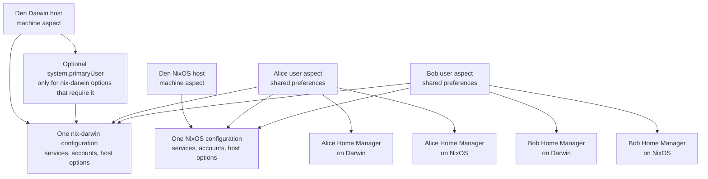

# Organizing Host and User Settings

Nix configurations often combine settings for a whole machine with settings
that belong to one account. Keeping those scopes clear matters on a single-user
laptop, and becomes essential when a host has several users or when a user's
preferences should follow them between Darwin and NixOS machines.

This article uses `system.defaults.screencapture.location` as a running
example of ownership and composition. It does not prescribe a screenshot
destination; the same reasoning applies to other macOS preferences.

## The Big Picture: Hosts and Per-User Homes

A host has one system configuration: nix-darwin on macOS, or NixOS on Linux.
That system configuration can declare or manage several accounts and connect
Home Manager, but it does not become a separate system configuration for
every user. Home Manager evaluates a separate home configuration for each
user on each host. Reusable Home Manager aspects can therefore follow a user
across operating systems, while each host keeps its own system-level policy.



Each host aspect and its host-class contributions are composed into that
host's one system module evaluation. Each user's Home Manager configuration
is separate from both system configurations and from the other user's
configuration. A shared Home Manager aspect can be included in Alice's user
aspect and apply on either host; host-specific settings remain in the
corresponding Darwin or NixOS host aspect.

In Den, `den.hosts` describes the machine and its roster. An aspect can own
class-specific configuration such as `.darwin` or `.homeManager`, and
`includes` composes reusable aspects into a host or user. A reusable user
preference aspect should be included by each user that wants that preference;
do not assume that adding a Home Manager block to a host aspect automatically
creates a separate configuration for every account.

## Decide Ownership Before Choosing an Option

For each setting, ask:

1. Is this machine policy that should be the same regardless of who logs in?
2. Is it a preference that belongs to one account and should follow that
   account to other hosts?
3. Does the relevant option actually support the desired scope, or does it
   only look user-related because its value contains a home path?
4. Which module should be the single writer for the setting?

The destination alone does not define ownership. A value may contain a user's
home directory but still be written by a host-scoped system option.

## Darwin Defaults and `system.primaryUser`

The nix-darwin option
`system.defaults.screencapture.location` looks like a system setting because
it is configured in the Darwin module system. In the nix-darwin revision used
by the example configuration, the activation implementation routes
`system.defaults.screencapture` through a helper that runs `defaults write`
as `config.system.primaryUser`.

That means the option writes a preference for the configured primary user; it
does not write a separate screenshot location for every account on the host.
On a four-user host, there is still only one value at this option path and one
`system.primaryUser`.

### What “Primary User” Means

In nix-darwin, “primary user” is an activation target: the account whose
macOS user-preference domains are changed by selected nix-darwin options.
System activation runs as root; for these settings, nix-darwin uses
`system.primaryUser` to enter that account's launchd context and run
`defaults write` as that user. The option exists as a transition mechanism
for settings that previously affected whichever user ran `darwin-rebuild`,
while nix-darwin moves toward system activation and first-class multi-user
support.

It is **not** macOS's notion of an administrator, the first account created,
the currently logged-in user, or a designation that makes settings apply to
all users. It does not create the account or grant it privileges. Choose an
account that is declared or otherwise exists on the machine and is the
intended recipient of nix-darwin-managed user preferences.

### Den's `primary-user` Battery

Den provides `den.batteries.primary-user` as a user-aspect battery. Including
it in `den.aspects.<user>.includes` marks that user as the primary user:

```nix
den.aspects.alice.includes = [
  den.batteries.primary-user
];
```

On Darwin, the battery sets `system.primaryUser` to the included user's name.
In this repository, `modules/users/mrolli.nix` includes the battery, and both
Darwin hosts roster `mrolli`, so Den selects `mrolli` as `system.primaryUser`
on those hosts. This is the mechanism that makes the account primary; the
host does not need a separate handwritten `system.primaryUser = "mrolli"`
definition.

The battery has other platform effects too: Den documents that on NixOS it
adds the user to the `wheel` and `networkmanager` groups, and on WSL it sets
`wsl.defaultUser`. So it is broader than a convenience for satisfying
nix-darwin's assertion. Include it only if those primary/admin-level effects
are intended for that user on the applicable systems.

Consequently, migrating nix-darwin user defaults to Home Manager is not by
itself enough to make `system.primaryUser` unset in this configuration: the
Den battery still sets it. If you want no primary user, remove
`den.batteries.primary-user` from the user aspect as well, and separately
decide whether its NixOS group and WSL default-user behavior should be
replaced or retained through other configuration.

### Which Options Require It?

In the pinned nix-darwin revision, the defaults activation implementation
marks these option groups as requiring `system.primaryUser`:

- `system.defaults.NSGlobalDomain` and `system.defaults.".GlobalPreferences"`
- `system.defaults.finder`, `system.defaults.dock`, and
  `system.defaults.menuExtraClock`
- `system.defaults.screencapture` and `system.defaults.screensaver`
- `system.defaults.controlcenter` and `system.defaults.spaces`
- `system.defaults.hitoolbox`, `system.defaults.magicmouse`,
  `system.defaults.trackpad`, and `system.defaults.universalaccess`
- `system.defaults.LaunchServices`, `system.defaults.ActivityMonitor`, and
  `system.defaults.WindowManager`
- `system.defaults.CustomUserPreferences`

These cover global appearance and keyboard preferences, Finder and Dock
behavior, screenshots, input/accessibility, and other user preference
domains. The list is based on the activation implementation, not on every
option under the `system.defaults` namespace.

The complete authoritative list is in nix-darwin's
`modules/system/defaults-write.nix`; it can change with the pinned revision.
The assertion emitted during evaluation names the exact options that require
the selection in the configuration being evaluated.

This is not a blanket rule that every `system.defaults` option requires a
primary user. For example, `system.defaults.loginwindow` is written to a
system preference domain and is not in the user-default requirement list.
Check the option's activation scope rather than inferring it from the
`system.defaults` prefix.

### Should You Set `system.primaryUser`?

`system.primaryUser` is one scalar setting on the Darwin host configuration,
not a declaration that each user aspect should make. The host chooses one
account as the target for nix-darwin options that historically affected the
user running `darwin-rebuild`. User aspects should not set it individually.
In a multi-user setup, different user aspects setting different names would
conflict; repeating the same name would still obscure which host owns the
choice.

The pinned nix-darwin revision defaults `system.primaryUser` to `null` and
asserts if an option requiring a primary user is configured without one. The
assertion lists the options that triggered the requirement and recommends
selecting the account previously used to run `darwin-rebuild`. Common
examples include `system.defaults.NSGlobalDomain`, `system.defaults.finder`,
`system.defaults.dock`, and `system.defaults.screencapture`.

Use it when you intentionally keep using those nix-darwin user-default
options: set the value once in the host's Darwin configuration, choose an
account that exists on that host, and understand that these defaults apply
only to that account. For an existing single-user Mac, this is usually the
account that owns the Mac and has historically run `darwin-rebuild`. On a
multi-user Mac, choose one account only if applying nix-darwin-managed
user-defaults to that account is intentional. It does not make those
preferences apply to every account.

Yes: if you move all configured options that require a primary user out of
nix-darwin and no other imported module requires it, you do not need to set
`system.primaryUser`. Home Manager runs each user's configuration in that
user's context, so those Home Manager preferences do not depend on
`system.primaryUser`.

Before removing it, check the fully composed Darwin configuration—not only
the visible host file—for any primary-user-required options contributed by
shared aspects, imported modules, or `CustomUserPreferences`. With the pinned
revision, leaving `system.primaryUser = null` while any such option is set
causes an evaluation assertion that identifies the requiring options. If
there are none, leaving it unset is appropriate. Do not set it merely because
the host has users or Home Manager configurations. The option's description
calls it a transition mechanism as nix-darwin moves toward first-class
multi-user activation, so it should not be treated as the general mechanism
for configuring all users.

In this repository, `darwin-base` currently defines user-domain
`system.defaults` values, including `NSGlobalDomain` and `screencapture`.
With the pinned nix-darwin revision, retaining those settings means each
Darwin host must select one `system.primaryUser` in its host-level
composition. If the desired behavior is instead to apply such preferences
independently to every account, move their ownership to per-user management
rather than selecting a primary user and expecting the other accounts to
inherit them.

**Practical recommendation for this configuration:** while those
`system.defaults` entries remain, set `system.primaryUser` once in each
Darwin host's system module to the account intended to receive them. For the
existing single-user hosts, that will normally be `mrolli`. If you move all
primary-user-required defaults out of nix-darwin and confirm none are
contributed elsewhere, remove the setting; Home Manager's per-user
configuration does not need a primary user. For a future four-user host, do
not pick a primary user just to satisfy the option and assume everyone
benefits: either intentionally designate one recipient for the nix-darwin
defaults, or migrate the user preferences that should differ or apply to
everyone into per-user Home Manager configuration.

### Examples Across Scopes

Machine policy belongs to the Darwin host and applies independently of the
primary-user choice:

```nix
{
  time.timeZone = "Europe/Zurich";
  system.stateVersion = 6;
}
```

By contrast, this nix-darwin module selects one recipient for its
user-domain defaults. Both preferences are written for `mrolli`, not for
every account on the host:

```nix
{
  system.primaryUser = "mrolli";

  system.defaults = {
    NSGlobalDomain.AppleShowAllExtensions = true;
    screencapture.disable-shadow = true;
  };
}
```

If a Finder preference should instead be independently owned by each
account, put it in that account's Home Manager activation. This example runs
as the Home Manager user, so Alice and Bob can include the same preference
aspect but choose different values in their respective configurations:

```nix
{ lib, ... }:
{
  home.activation.finderVisibility =
    lib.hm.dag.entryAfter [ "writeBoundary" ] ''
      /usr/bin/defaults write com.apple.finder AppleShowAllFiles -bool true
    '';
}
```

For example, Alice's configuration could write `true` and Bob's could write
`false`. Do not also define `system.defaults.finder.AppleShowAllFiles` for
that host: that would introduce a second writer and would only target the
primary user. Keep this activation in a Darwin-only user aspect, and use the
per-user configuration context for any account-specific value.

Deriving a path from `users.users.<name>.home` can avoid hardcoding a home
directory, but it does not change which account receives the preference.

For actual machine policy, Darwin host aspects are still the right place:
host identity, services, power policy, account declarations, and defaults that
are intended to apply to the primary user. Keep the single primary-user
selection in that host-level composition whenever nix-darwin options require
it; do not distribute the selection among user aspects.

## User Preferences with Home Manager

When a preference should belong to each user independently, put its ownership
in a user aspect's `homeManager` configuration. A shared aspect can define the
preference behavior once; each user's aspect opts into it with `includes`.
Home Manager evaluates that aspect once for Alice, once for Bob, and so on,
so the value can be user-specific and can follow the account across Darwin
and NixOS hosts, provided Home Manager is enabled for that user on each host.

For example, a portable user aspect can own shell and Git preferences. Include
this Home Manager module from the user's Den aspect; that same user aspect can
then be used by a Darwin host and a NixOS host:

```nix
{ ... }:
{
  programs.zsh = {
    enable = true;
    autosuggestion.enable = true;
  };

  programs.git = {
    enable = true;
    userName = "Alice Example";
    userEmail = "alice@example.org";
  };

  home.sessionVariables.EDITOR = "nvim";
}
```

These options configure Alice's home, not the machine. Bob can use the same
reusable aspect with his own values, and neither user's settings need to be
copied into the Darwin or NixOS host module. App configuration files managed
through Home Manager can be shared the same way when the application and
configuration format are available on both platforms.

Keep genuinely platform-specific preferences separate or guard them by
platform. For example, a macOS `defaults` activation belongs only in the
Darwin Home Manager evaluation; a Linux desktop preference should only be
enabled where its desktop environment exists. Do not try to make a macOS
preference portable merely by placing it in a shared user aspect.

If a user preference needs a home-relative path, use the Home Manager
configuration's `config.home.homeDirectory`, not the shell variable `$HOME`
inside Nix evaluation. `$HOME` is a runtime shell variable and is not
automatically a Nix variable.

For macOS preferences without a native Home Manager option, one possible
mechanism is an idempotent per-user Home Manager activation step that writes
the preference in that user's context. For the screenshot example, the
activation would set the `com.apple.screencapture` preference using a
destination supplied by that user's configuration. This article deliberately
does not choose that destination or require this mechanism; the correct choice
depends on the setting and the desired activation behavior.

If Home Manager owns a preference, leave the corresponding nix-darwin
`system.defaults` key unset. Two managers writing the same macOS preference
can overwrite each other on later activations.

## What `lib.mkDefault` Can—and Cannot—Do

Nix module priorities are useful for fallback values. A shared host aspect
could provide a default:

```nix
{ lib, ... }:
{
  system.defaults.screencapture.location =
    lib.mkDefault someHostDefault;
}
```

A stronger definition can override that default. This is a precedence rule;
it does not change the option's scope. The final Darwin configuration still
has one value for `system.defaults.screencapture.location`, and nix-darwin
still applies that setting to its configured primary user.

Therefore, `lib.mkDefault` is appropriate when several aspects contribute
fallbacks for one host-level value. It is not a way to give four users four
different values at the same host option. Avoid using `mkForce` to obscure an
ownership conflict; move the setting to the scope that matches its intent.

## Den Routing Does Not Multiply Host Options

Den can route configuration across entity boundaries. For example,
`provides.to-hosts` can deliver user-derived host-class configuration to
hosts where that user is present. This is useful when a host genuinely needs
information from a user aspect.

Routing does not create four independent Darwin evaluations for a host. If
four users route different values to the same Darwin option, those definitions
still meet in one module merge. They may conflict, or a priority may choose
one, but neither outcome represents independent per-user preference storage.

Use cross-entity routing for values that should affect the host configuration.
Use each user's Home Manager configuration for values that should remain
independent per account.

## Aspect Organization That Scales

A practical structure separates reusable concerns from their composition:

```text
modules/
├── aspects/
│   ├── core/
│   │   ├── darwin-base.nix          # machine-wide Darwin policy
│   │   └── nixos-base.nix           # machine-wide NixOS policy
│   ├── users/
│   │   └── common-home.nix          # portable Home Manager preferences
│   └── macos/
│       └── user-preferences.nix     # macOS-only per-user preferences
├── hosts/
│   ├── galadriel.nix                # Darwin host and host-only choices
│   └── rivendell.nix                # NixOS host and host-only choices
└── users/
    └── alice.nix                    # Alice's shared and platform-specific home
```

The host aspects compose their own system policy. For example, the Darwin
host can set its machine name and macOS services, while a NixOS host can
configure its host name, boot, networking, and Linux services:

```nix
{
  den.aspects.galadriel.darwin = {
    networking.hostName = "galadriel";
    services.openssh.enable = true;
  };

  den.aspects.rivendell.nixos = {
    networking.hostName = "rivendell";
    services.openssh.enable = true;
    boot.loader.systemd-boot.enable = true;
  };
}
```

The names and options above are illustrative; use the options and platform
modules appropriate to each real host. The important boundary is that host
hardware, boot, network, and system services belong to that host's system
aspect, not to a shared user preference aspect.

`darwin-base` and `nixos-base` should own settings whose scope is the
respective operating system or machine. A portable Home Manager aspect can
own account-level behavior that follows a user across hosts; platform-specific
Home Manager aspects can add preferences that only make sense on one OS.
Each user's aspect chooses which user concerns to include, while each host
composes its own machine policy. This keeps multiple users and multiple
operating systems explicit without copying preference implementations.

The file layout is a guide, not a requirement to create a file for every
setting. Related settings can share an aspect when they have the same owner
and lifecycle.

## Choosing Between the Patterns

|Need|Suitable ownership|
|---|---|
|Hostname, services, power, machine policy|Darwin host aspect|
|Boot, filesystems, networking, and Linux services|NixOS host aspect|
|A Darwin default intentionally applied to one account|nix-darwin `system.defaults` with one host-level `system.primaryUser`|
|A fallback for one host-level value|`lib.mkDefault` plus a clear stronger host definition|
|Portable preference following a user between Darwin and NixOS|Shared user aspect with Home Manager configuration enabled on both hosts|
|An OS-specific preference|Platform-specific Home Manager aspect or platform-guarded user module|
|A distinct preference for every user|User aspect with Home Manager configuration|
|User-derived data that must alter one host-level setting|Den cross-entity routing, with one final host value|

For `system.defaults.screencapture.location`, first decide whether the desired
behavior is one primary-user setting per machine or a user-owned preference
that follows each account. If using nix-darwin's option, select that one
recipient at the host level; if every account needs its own value, use a
per-user mechanism instead. The option name or a path under a home directory
alone does not answer that ownership question.

## References

- [Den: Configure Aspects](https://den.denful.dev/guides/configure-aspects/)
- [Den batteries reference](https://den.denful.dev/reference/batteries/)
- [nix-darwin `system.defaults.screencapture` option](https://mynixos.com/nix-darwin/option/system.defaults.screencapture.location)
- [Pinned nix-darwin defaults activation implementation](https://github.com/nix-darwin/nix-darwin/blob/c3e90c89649b07d1a96e4b9dd6cd0d6e44b91a74/modules/system/defaults-write.nix)
- [Pinned nix-darwin primary-user option and assertion](https://github.com/nix-darwin/nix-darwin/blob/c3e90c89649b07d1a96e4b9dd6cd0d6e44b91a74/modules/system/primary-user.nix)
- [Home Manager activation options](https://nix-community.github.io/home-manager/options.xhtml#opt-home.activation)
- Local examples: [Aspects Design Patterns](patterns_aspects.md) and
  [Script Deployment Patterns](patterns_script_deployment.md)
